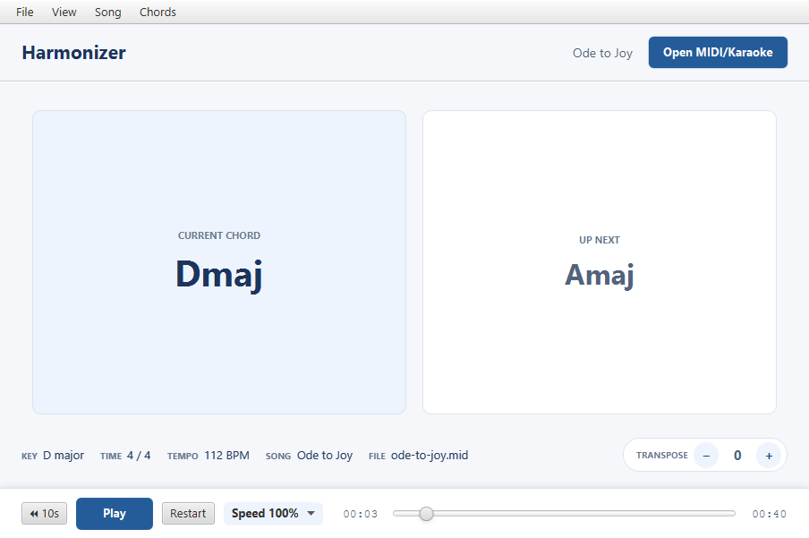
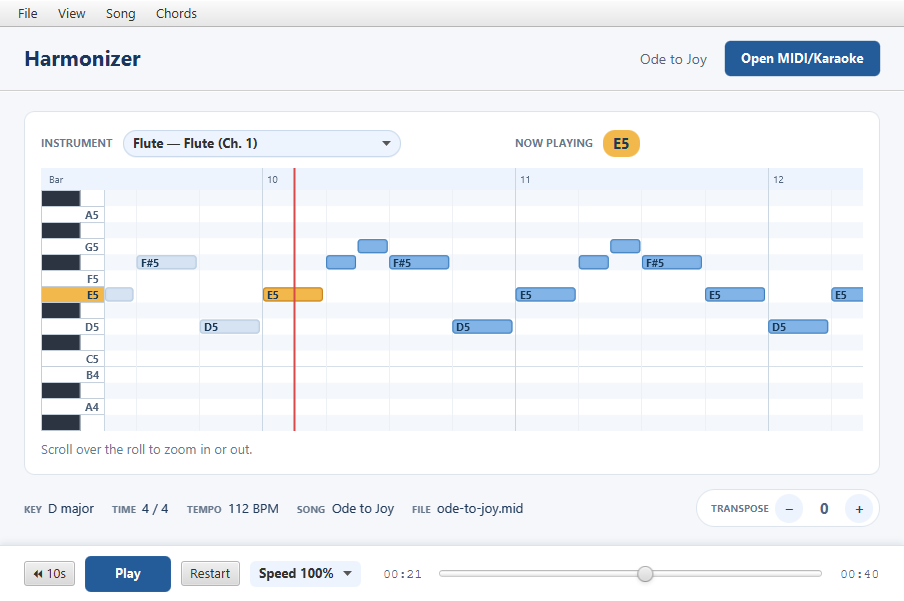

# Harmonizer

[](https://github.com/mflores2415/harmonizer/actions/workflows/ci.yml)

Harmonizer is a desktop app for learning songs from MIDI and karaoke files. It works out
the chords and key of a song, shows each instrument's notes on a scrolling piano roll, and
plays the song back in sync, slower if you're practicing, or in another key.





## Download and run

Get the latest build for your system from the
[**Releases page**](https://github.com/mflores2415/harmonizer/releases/latest). It includes
its own Java runtime, so there's nothing else to install, plus two demo songs to try.

| System | Download | To run |
|---|---|---|
| Windows | `Harmonizer-…-windows.zip` | Unzip, then open `Harmonizer\Harmonizer.exe` |
| macOS (Apple silicon) | `Harmonizer-…-macos.zip` | Unzip, then open `Harmonizer.app` |
| Linux | `Harmonizer-…-linux.tar.gz` | `tar xzf` it, then run `Harmonizer/bin/Harmonizer` |

The builds aren't code-signed, so the first launch shows a warning. On Windows choose
**More info → Run anyway**; on macOS right-click the app and choose **Open**.

Then use **Open MIDI/Karaoke** and pick `ode-to-joy.mid` or `greensleeves.mid`, or any
`.mid`, `.midi` or `.kar` file of your own.

## Features

- **Chords as you listen.** The current and upcoming chord are shown in time with
  playback. *Detailed* mode shows every change of chord quality; *Steady* mode keeps a
  chord until its root changes, which is easier to follow when playing along.
- **Key and time signature.** The key is read from the file, or estimated from the notes
  when the file has none or gets it wrong (marked "estimated"). Bars follow the file's time
  signatures, including 6/8 and 12/8 and changes mid-song.
- **Note roll for any instrument** (View → Instruments). Notes scroll toward a fixed
  playhead, the keyboard lights up what's sounding, and drum parts are labeled by drum name.
  Scroll over the roll to zoom.
- **Practice speed.** Play at 25 %, 50 %, 75 % or up to 150 %, or type any tempo in BPM.
  Pitch stays the same.
- **Transpose** the whole song up or down by semitones (Ctrl+Up/Down). Chords, key and the
  saved file all follow; drums are left alone.
- **Correct a chord name** when the detector gets it wrong (Chords → Correct chord name…,
  or right-click the chord cards). This changes only the label, not the music.
- **Save** the song with its chords embedded as lyrics, so any karaoke player can show them.

## How it works

**Chord recognition** (`ChordDetector`, `Chord`). At every moment where a note starts or
stops, the pitched notes sounding across all instruments are reduced to a set of the 12
pitch classes, stored as a bitmask. Each root × chord quality (major, minor, augmented,
diminished, four kinds of seventh) is scored by how many of its notes are present, with a
penalty for extra notes, and the best match wins.

**Key detection** (`KeyDetector`, `KeyResolver`). This uses the
[Krumhansl–Schmuckler](https://rnhart.net/articles/key-finding/) algorithm. It adds up how
long each pitch class sounds, then correlates that profile with the Krumhansl–Kessler major
and minor key profiles for all 24 keys and picks the best fit. The file's own key
signature is kept when it fits the notes. A key signature can't tell a major key from its
relative minor (C major and A minor share one), so the better-fitting of the two is used.
A signature that fits poorly, such as the default C major many tools write, is replaced
by the estimate.

**Bars and beats** (`BarGrid`). Converts MIDI ticks to bars using every time-signature
event. Compound meters are counted in dotted-quarter beats, the way they're felt (a 12/8 bar
has four beats, not twelve).

**Note roll** (`NoteRollDisplay`). The roll is drawn on a single canvas rather than as
thousands of JavaFX nodes. The player reports its position about 10 times a second, so the
view estimates the playback rate from those reports and moves the notes smoothly between
them.

**Playback** (`MusicPlayer`). Built on the Java Sound sequencer. Speed uses the sequencer's
tempo factor, so tempo changes inside the song are scaled too. Chords reach the display as
lyric events (`"Cmaj Gmaj"` = current and next chord) that Harmonizer writes into the
sequence (`ChordLyrics`). That's also how saved files carry their chords.

**Transposition** (`Transposer`). Moves every non-drum note and rewrites the key signature
(each semitone adds seven sharps, modulo 12, spelled with the fewest accidentals), then
re-runs the analysis.

## Build from source

Requires Java 25+ and Maven 3.9+ (JavaFX is downloaded by Maven).

```shell
mvn javafx:run     # run the app
mvn verify         # build and run the tests
scripts/package.sh # build a self-contained app for this OS into target/dist
```

### Releases

Pushing a version tag builds the apps for Windows, macOS and Linux on GitHub Actions and
publishes them as a release:

```shell
git tag v1.0.0
git push origin v1.0.0
```

## Project layout

- `src/main/java/harmonizer/`
  - `midi` – MIDI plumbing with no musical decisions: event constants, reading notes
    (`NoteReader`), General MIDI names, and the chord-lyric format (`ChordLyrics`).
  - `model` – the song and its analysis. `Song` is the entry point; `MidiSongAnalyzer`
    coordinates `SongMetadata`, `KeyResolver`, `ChordDetector` and the instrument parts.
  - `player` – playback behind the `MusicPlayback` interface.
  - `ui` – JavaFX views and dialogs. They show state and report what the user asks for;
    they don't change the song themselves.
  - `controller` – carries out user requests on the song and the player.
- `src/test/java/` – unit tests mirroring the packages, plus `SampleSongsTest`, which
  analyzes real songs.
- `samples/` – `ode-to-joy.mid` and `greensleeves.mid`, public-domain tunes arranged for
  this project. They ship with the app and are always tested.
- `local-samples/` (git-ignored, optional) – put any other MIDI files here for local
  testing. `SampleSongsTest` checks the ones it knows about when they're present and
  skips them otherwise.
- `scripts/package.sh` – builds the self-contained app with `jpackage`.
- `files/` – the original course documents (use cases, storyboard), a General MIDI
  instrument list, and the 2016 MIDI prototype this project grew out of.

## License

Harmonizer is released under the [MIT License](LICENSE). The demo songs in `samples/`
are public-domain tunes. The course materials in `files/` are kept for reference and are
not covered by the license.
